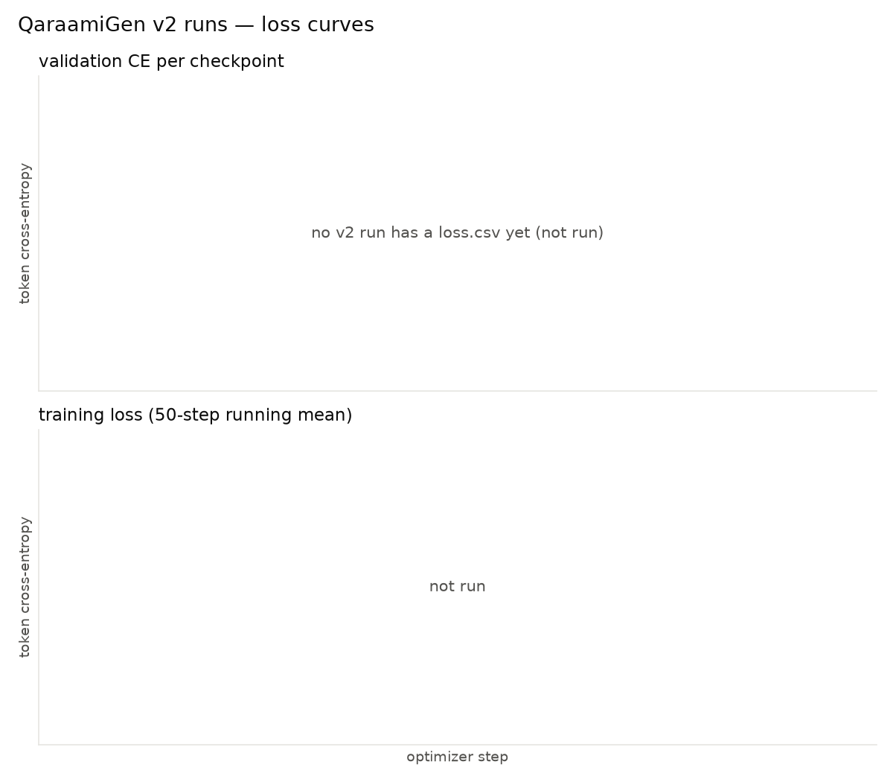
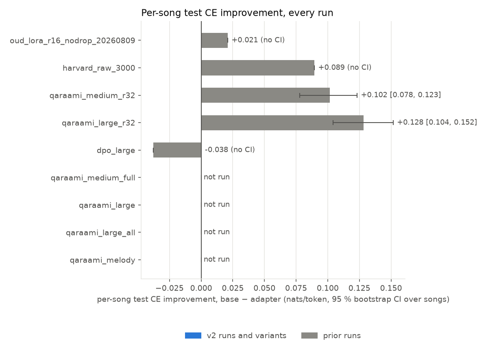
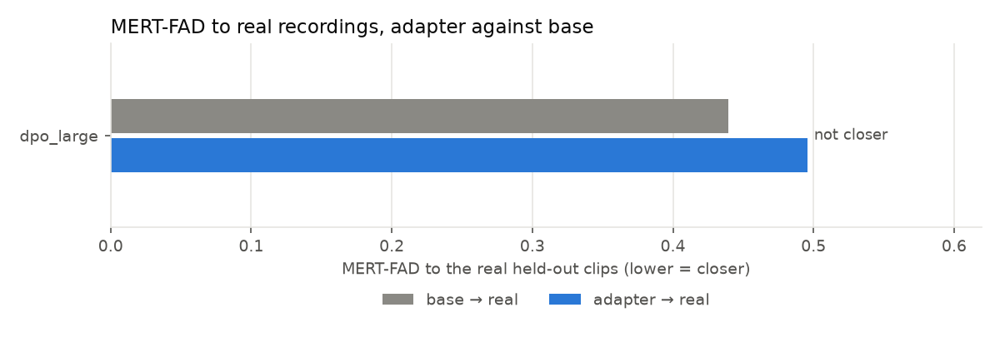
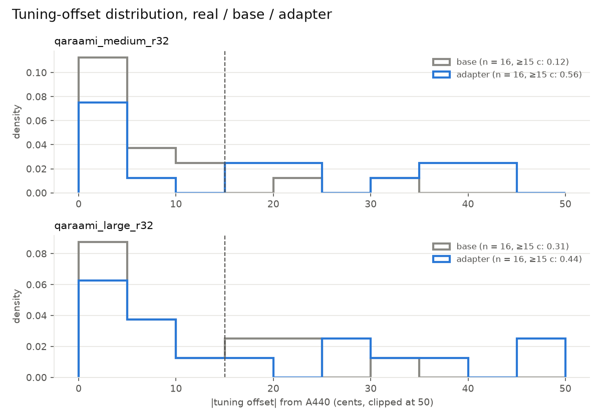
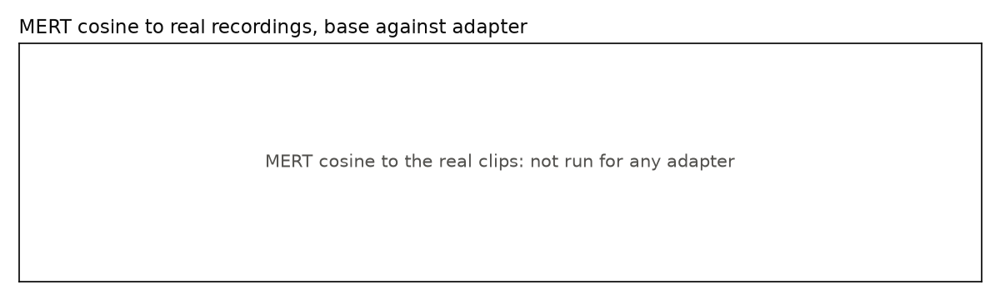

# QaraamiGen v2 — model report

*Generated by `apps/ai-service/scripts/model_report.py` on 2026-09-26 from `runs/*/eval_*.json`, `eval_round_*.json`, `test_ce.json`, `loss.csv`, `config.json`, the captions files, `data/listening/*.json` and the adapter registry; nothing typed by hand. A run or measurement that has not happened reads "not run". Per-song test CE is the mean token cross-entropy over held-out test songs with a bootstrap 95 % CI over songs on base − adapter; trackable melody is the CREPE voiced fraction and PCS the pentatonic conformity of the A/B clips (same captions and seeds on both sides); MERT-FAD is the Fréchet distance between MERT embeddings of generated clips and of real held-out clips; the tuning column is the share of clips whose global tuning offset is at least 15 cents off A440. DPO rows compare the round's start adapter ("base") with its end ("adapter"). Hours are source-audio hours from the set card, or `~` a 50 %-overlap estimate from the clip count.*

## (a) Results across all runs

| run | group | base model (recipe) | corpus sets (clips, source audio h) | best ckpt | val CE base → adapter | per-song test CE base → adapter | trackable melody base → adapter | PCS base → adapter | MERT-FAD to real adapter / base | closer to real | \|offset\| ≥ 15 c real / base / adapter | A/B set | blind result |
| --- | --- | --- | --- | --- | --- | --- | --- | --- | --- | --- | --- | --- | --- |
| oud_lora_r16_nodrop_20260809 | prior: oud (small) | musicgen-small (LoRA r16 α32 (q,k,v,out)) | unlabelled 1921 clips (~4.1 h) | ckpt_step_0500 | 4.5132 → 4.4785 | 2.6302 → 2.6092 (Δ +0.021, clip mean, no CI) | not run | not run | not run | not run | not run | `data/oud_ab_listening/` | no blind session yet |
| harvard_raw_3000 | prior: harvard_raw (small) | musicgen-small (LoRA r16 α32 (q,k,v,out)) | unlabelled 11386 clips (~24.0 h) | ckpt_step_2750 | 4.6262 → 4.5501 | 4.8363 → 4.7468 (Δ +0.089, clip mean, no CI) | not run | not run | not run | not run | not run | not run | no blind session yet |
| qaraami_medium_r32 | prior: medium r32 | musicgen-medium (LoRA r32 α64 (q,k,v,out,fc1,fc2)) | band_qaraami 3256 clips (~14.3 h), harvard_raw 5277 clips (~22.4 h), oud_ilkacase 1129 clips (~4.8 h) | ckpt_step_2750 | 4.4584 → 4.3724 | 4.1011 → 3.9996 (Δ +0.102 [0.078, 0.123], n = 27 songs) | 0.409 → 0.515 | 0.8212 → 0.8047 | not run | not run | – / 0.12 / 0.56 | `data/ab_medium/` (16 pairs) | adapter 3 / base 0 / neither 13 of 16, rate 0.19 [0.07, 0.43] (khalid 2026-09-08) adapter 1 / base 0 / neither 15 of 16, rate 0.06 [0.01, 0.28] (khalid 2026-09-24) |
| qaraami_large_r32 | prior: large r32 | musicgen-large (LoRA r32 α64 (q,k,v,out,fc1,fc2)) | band_qaraami 3256 clips (~14.3 h), harvard_raw 5277 clips (~22.4 h), oud_ilkacase 1129 clips (~4.8 h) | ckpt_step_2750 | 4.4305 → 4.3244 | 4.0750 → 3.9469 (Δ +0.128 [0.104, 0.152], n = 27 songs) | 0.355 → 0.683 | 0.8719 → 0.7848 | not run | not run | – / 0.31 / 0.44 | `data/ab_large/` (16 pairs) | adapter 11 / base 2 / neither 3 of 16, rate 0.69 [0.44, 0.86] (khalid 2026-09-08) adapter 6 / base 0 / neither 10 of 16, rate 0.38 [0.18, 0.61] (khalid 2026-09-08) |
| dpo_large | prior: DPO large | musicgen-large (DPO β10, lr 2e-05, 1 round(s)) | band_qaraami 3256 clips (~14.3 h), harvard_raw 5277 clips (~22.4 h), oud_ilkacase 1129 clips (~4.8 h) | round_1/adapter | not run | 4.1418 → 4.1797 (Δ -0.038, clip mean, no CI) | 0.505 → 0.553 | 0.9244 → 0.9211 | 0.495 / 0.439 | no | not run | `data/ab_dpo_large/` (40 pairs, 15 s) | adapter 22 / base 12 / neither 6 of 40, rate 0.55 [0.40, 0.69] (khalid 2026-09-24) adapter 12 / base 10 / neither 18 of 40, rate 0.30 [0.18, 0.45] (khalid 2026-09-24) |
| qaraami_medium_full | v2 | not run | | | | | | | | | | | |
| qaraami_large | v2 | not run | | | | | | | | | | | |
| qaraami_large_all | v2 | not run | | | | | | | | | | | |
| qaraami_melody | v2 | not run | | | | | | | | | | | |

Best evaluated run by per-song CE improvement (5 run(s) ranked; no rankable MERT-FAD yet): **qaraami_large_r32** (research-only). Not ranked by FAD: dpo_large (DPO round) — a DPO round's fad_to_real_oud_test measures 15 s candidates against the reward-model reference pool, another design than scale_eval's real held-out pool, so the numbers are shown in the rows but not compared across runs.

Eval files read (eval_<run>.json first, else the newest eval_*.json): oud_lora_r16_nodrop_20260809 → `oud_eval_test_ce.json`; harvard_raw_3000 → `test_ce.json`; qaraami_medium_r32 → `eval_medium.json`; qaraami_large_r32 → `eval_large.json`; dpo_large → `eval_round_1.json`.

## (b) Improvement log

not run — `docs/eval/IMPROVEMENT_LOG.md` does not exist yet (Phase 4 writes it).

## (c) Corpus hours per run

| run | captions | sets (clips, songs, source audio; card window total) | unique songs, unique hours (est.) | splits | rights rows → verdict |
| --- | --- | --- | --- | --- | --- |
| oud_lora_r16_nodrop_20260809 | `data/oud_captions.jsonl` | unlabelled: 1921 clips, 28 songs, ~4.1 h | 28 songs, ~4.1 h | test 276 (3 songs), train 1512 (22 songs), val 133 (3 songs) | none 1921 → **rights unverified** |
| harvard_raw_3000 | `data/captions.jsonl` | unlabelled: 11386 clips, 119 songs, ~24.0 h | 119 songs, ~24.0 h | test 1076 (12 songs), train 9174 (95 songs), val 1136 (12 songs) | none 11386 → **research-only** |
| qaraami_medium_r32 | `data/scale_captions.jsonl` | band_qaraami: 3256 clips, 180 songs, ~14.3 h; harvard_raw: 5277 clips, 105 songs, ~22.4 h; oud_ilkacase: 1129 clips, 28 songs, ~4.8 h | 311 songs, ~41.6 h | test 797 (30 songs), train 7857 (252 songs), val 1008 (29 songs) | band_qaraami 3256, harvard_raw 5277, oud_ilkacase 1129 → **research-only** |
| qaraami_large_r32 | `data/scale_captions.jsonl` | band_qaraami: 3256 clips, 180 songs, ~14.3 h; harvard_raw: 5277 clips, 105 songs, ~22.4 h; oud_ilkacase: 1129 clips, 28 songs, ~4.8 h | 311 songs, ~41.6 h | test 797 (30 songs), train 7857 (252 songs), val 1008 (29 songs) | band_qaraami 3256, harvard_raw 5277, oud_ilkacase 1129 → **research-only** |
| dpo_large | `data/scale_captions.jsonl` | band_qaraami: 3256 clips, 180 songs, ~14.3 h; harvard_raw: 5277 clips, 105 songs, ~22.4 h; oud_ilkacase: 1129 clips, 28 songs, ~4.8 h | 311 songs, ~41.6 h | test 797 (30 songs), train 7857 (252 songs), val 1008 (29 songs) | band_qaraami 3256, harvard_raw 5277, oud_ilkacase 1129 → **research-only** |
| qaraami_medium_full | not run | | | | |
| qaraami_large | not run | | | | |
| qaraami_large_all | not run | | | | |
| qaraami_melody | not run | | | | |

## (d) What the model does and does not do

- Every evaluated adapter with a CI (2) lowers held-out per-song token cross-entropy against its own base, with a 95 % bootstrap CI over songs that excludes zero.
- 3 further run(s) report a test CE without a CI (oud_lora_r16_nodrop_20260809, harvard_raw_3000, dpo_large): 2 below the comparison point, dpo_large not.
- Every evaluated adapter (3) produces more trackable melody (CREPE voiced fraction) than its base on the A/B clips.
- Pentatonic conformity (PCS) falls against base in every evaluated run (3): by this scorer the adapters' extra sung material is less strictly pentatonic, or harder to track.
- No adapter's outputs are closer to the real held-out qaraami clips in MERT space than its base's outputs (MERT-FAD, 1 run(s) measured), so no run can claim to have moved toward the real recordings by this measure.
- The tuning-offset distribution of real, base and adapter clips has not been measured on any run.
- Blind A/B, ab_medium (khalid, 2026-09-08): the adapter was preferred in 3 of 16 pairs, the base in 0, neither in 13; Wilson 95 % [0.07, 0.43], the interval excludes one half, a preference against the adapter.
- Blind A/B, ab_medium (khalid, 2026-09-24): the adapter was preferred in 1 of 16 pairs, the base in 0, neither in 15; Wilson 95 % [0.01, 0.28], the interval excludes one half, a preference against the adapter.
- Blind A/B, ab_large (khalid, 2026-09-08): the adapter was preferred in 11 of 16 pairs, the base in 2, neither in 3; Wilson 95 % [0.44, 0.86], the interval includes one half, no preference established at this n.
- Blind A/B, ab_large (khalid, 2026-09-08): the adapter was preferred in 6 of 16 pairs, the base in 0, neither in 10; Wilson 95 % [0.18, 0.61], the interval includes one half, no preference established at this n.
- Blind A/B, ab_dpo_large (khalid, 2026-09-24): the adapter was preferred in 22 of 40 pairs, the base in 12, neither in 6; Wilson 95 % [0.40, 0.69], the interval includes one half, no preference established at this n.
- Blind A/B, ab_dpo_large (khalid, 2026-09-24): the adapter was preferred in 12 of 40 pairs, the base in 10, neither in 18; Wilson 95 % [0.18, 0.45], the interval excludes one half, a preference against the adapter.
- Rights: research-only adapters (Harvard rows in training): harvard_raw_3000, qaraami_medium_r32, qaraami_large_r32, dpo_large; releasable adapters: none; rights unverified from the captions rows: oud_lora_r16_nodrop_20260809.
- Every adapter generates at most 30 s of audio per request (the service cap); nothing here models song form, lyrics or Somali-language singing: the captions carry no words and the models emit no text.

## (e) Audible Somali-ness

No native-listener Turing result exists yet, and no MERT distance to the real recordings has been measured for the best run (qaraami_large_r32); nothing here is a perceptual claim.

## Figures

